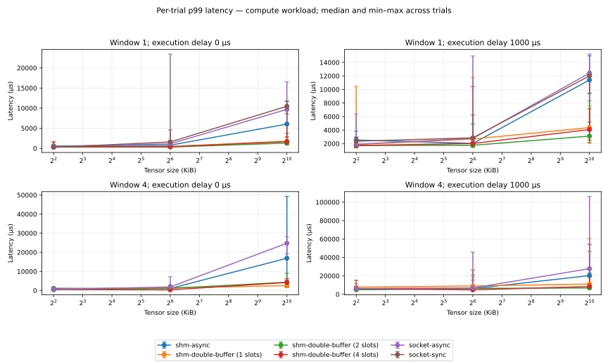
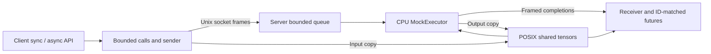

# EdgeRPC

A C++17 runtime that sends float32 tensors between a client and a **CPU simulated accelerator** in separate processes. It supports synchronous/asynchronous Unix-socket calls, POSIX shared memory, and registered 1/2/4-slot buffer pools. The executor computes `2*x+1` or echoes its input.

This is a software prototype for studying communication and ownership. It has no Qualcomm FastRPC, QNN, model graph or NPU implementation. [Qualcomm mapping](docs/qualcomm_mapping.md) explains the related design concerns and hardware differences.

## Measured findings

On the recorded Linux x86_64 cloud host, warm reuse reduced median latency for selected tensors, while fresh SHM was slower than socket async at 4 KiB. Results vary with size/concurrency and have broad tails.

| Mode | Median p50, μs |
|---|---:|
| Socket async | 411.3 |
| Fresh SHM async | 273.5 |
| Registered two-slot pool | 79.1 |

These are medians of five trials at **64 KiB compute, one worker, window 1, zero simulated delay, timing on**. They include warm calls only. The full experiment retained 665 trials across 133 configurations; startup, variability and negative results are in [the measured findings](docs/benchmark-results.md). Correctness on another platform does not extend these timings to that platform.



## Quick start

Requires Linux/macOS, a C++17 compiler, CMake 3.20+ and Python 3.8+. No third-party C++ libraries, hardware SDK or runtime service is required. On macOS install Command Line Tools if needed (`xcode-select --install`), plus CMake/Python, for example `brew install cmake python`.

```sh
git clone https://github.com/Somya2907/EdgeRPC.git
cd EdgeRPC
cmake -S . -B build -DCMAKE_BUILD_TYPE=Release \
  -DEDGERPC_SANITIZERS=OFF -DEDGERPC_THREAD_SANITIZER=OFF
cmake --build build --parallel 4
python3 scripts/validate_platform.py
```

Expect all seven CTest suites and 18 platform checks to pass. The validator starts/stops its own private server and saves logs, hashes and CSV smoke samples under `results/platform-*`. The cloud environment needs `export PATH="/workspace/.edgerpc-tools/bin:$PATH"` first. [The full quick start](docs/quickstart.md) covers a two-terminal demo, chart dependencies, containers and troubleshooting; [fresh-checkout evidence](docs/evidence/phase6/README.md) records the exact tested revision.

## Architecture and implemented features



Socket mode carries tensors in frames; SHM modes carry tensor data through mappings and control through the socket. Vector/backend copies remain.

- Thread-safe submissions, request-ID matching and futures; sync waits on the same async transport.
- Bounded total outstanding calls and waiting server tasks, with explicit request-local overload errors.
- Validated per-request shared regions and registered 1/2/4-slot reuse with generations and explicit ownership.
- Versioned frames, partial I/O, per-transfer deadlines, disconnect/close cleanup and safe socket-path handling.
- Four benchmark modes, optional stage telemetry, actual socket-byte counters, repeated trials, CSV reports and SVG/PNG charts.
- Separate-process correctness, concurrency/crash/overload tests and native Linux x86_64/ARM64/macOS ARM64 CI.

The server serves one active client connection at a time; its default is one worker and 32 waiting tasks. Client capacity defaults to 32 total outstanding calls. Tensor size is zero through 2,097,152 float32 elements (8 MiB). [Architecture and tradeoffs](docs/architecture.md), [wire protocol](docs/protocol.md), [SHM contract](docs/shared-memory.md) and [pool ownership](docs/pipeline.md) specify the lifecycle and limits.

## Library API

```cpp
#include <edgerpc/client.hpp>

edgerpc::EdgeRpcClient client("/path/to/private/rpc.sock");
auto sync = client.infer_sync({-1.0f, 0.0f, 2.0f}); // {-1, 1, 5}
auto pending = client.infer_async({1.0f, 2.0f});
auto result = pending.get();
auto shared = client.infer_async({3.0f}, edgerpc::Operation::Compute,
                               edgerpc::TensorTransport::SharedMemory).get();
```

The server must already be running at that private socket path. To enable pooled calls, construct with `PoolOptions{2, 1024}` as the fourth argument (after timeout and pending capacity), then select `TensorTransport::SharedPool`. The [pool example](docs/pipeline.md) shows this in context. Keep the client alive until concurrent callers finish; `close()` joins its threads. No installable CMake package or stable C++ ABI is promised.

## Benchmarks and containers

These self-contained scripts own and clean up their private servers:

```sh
./scripts/run_benchmarks.sh                 # Socket sync samples
./scripts/run_pipeline_benchmarks.sh        # Synthetic overlap at 1/2/4 slots
python3 scripts/run_comparisons.py --smoke --no-plots
```

Smoke is functional validation only. For full five-trial comparisons use `python3 scripts/run_comparisons.py`; omit `--no-plots` after installing chart dependencies as described in [the quick start](docs/quickstart.md#short-comparison-smoke-and-report-regeneration). Use Release with both sanitizer options OFF and no concurrent builds/tests while timing. [Methodology](docs/benchmarks.md) defines controls, initialization/warm-up boundaries and interpretation. Raw data and checksums are retained with [the findings](docs/benchmark-results.md).

```sh
docker build -f docker/Dockerfile -t edgerpc:validation .
docker run --rm --shm-size=256m edgerpc:validation
```

The container runs both processes and the full validator as an unprivileged user. Native Linux images on x86_64/ARM64 and native macOS ARM64 checks pass; see [portability evidence](docs/portability.md).

## Reliability and limits

Linux CTest contains 115 checks/groups across seven suites; macOS has 114 because one allocation-failure injection is Linux-only. Release and Linux ASan/UBSan pass. Optional ThreadSanitizer has a documented system libstdc++ exception-lifetime warning reproduced with a standalone standard-library program; its final unsuppressed run is not clean. [Sanitizer commands and evidence](docs/portability.md#sanitizers) retain that limitation.

This is a **same-user, trusted-client local demo**. Socket/SHM permissions are 0600; use a private socket directory. Queue limits count requests, not memory. A maximum SHM request reserves 16 MiB before vector copies. A killed creator can leave an orphan name before admission/registration; use identified-name recovery. Metadata checks do not prevent malicious mutation by the owner.

There is no authentication, tenant isolation, fair multi-client scheduling, total inference deadline, automatic retry or forced cancellation of executing work. `future.wait_for()` does not cancel the server. Windows/macOS Intel are unvalidated. CPU/RSS and device-side profiling, model loading and real hardware backends remain follow-ups; the [backend design](docs/backend-extension.md) describes the future boundary.

## Project status

All six completion phases are delivered, including verified documentation and release preparation. [Release notes](docs/release-notes.md) list scope, compatibility, evidence and remaining limits. The selected policy leaves tags and publication for later. [The completion roadmap](docs/completion-plan.md) is the current status source; [the original plan](Plan.md) is retained as a historical design/session guide.
