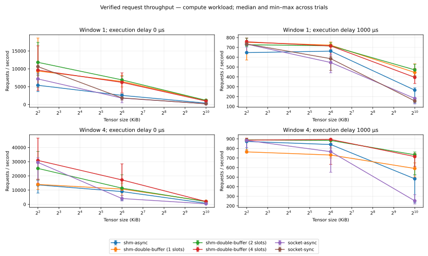
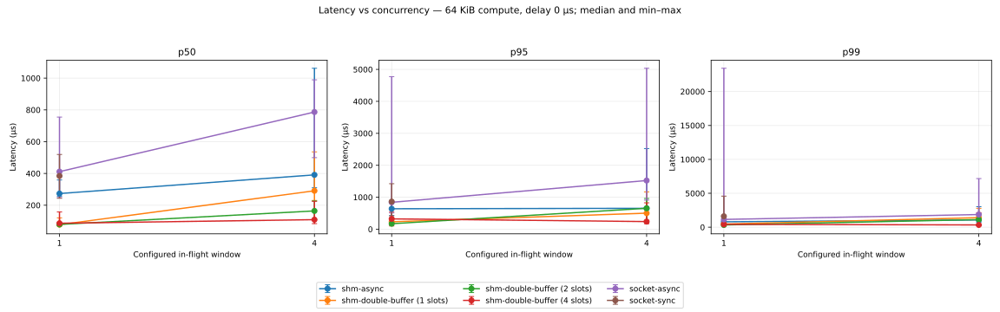
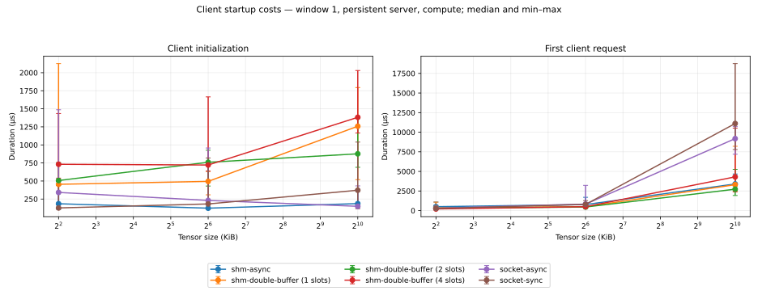
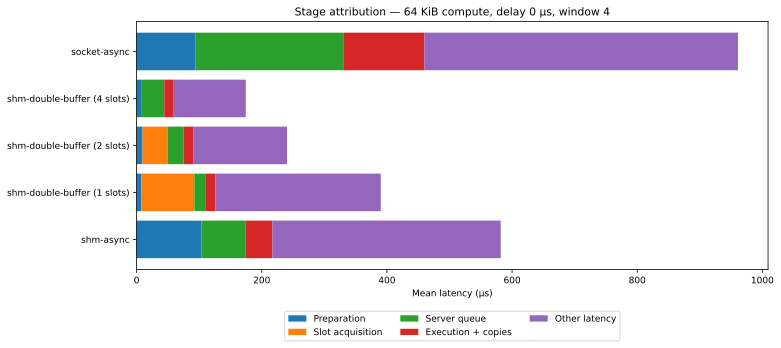
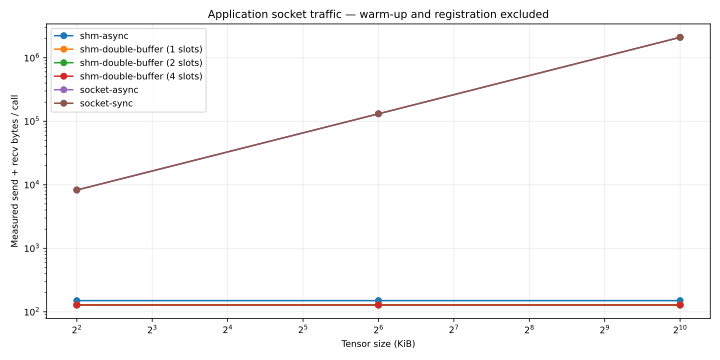

# Repeated transport measurements

665 successful trials; 200 measured requests per trial; 5 repetitions per configuration. All warm-up/measured outputs verified.

Values below are the median of per-trial statistics, with the minimum–maximum range across trials. Raw latencies are not pooled across trials. Queue depth, slot capacity, and instrumentation remain explicit. CPU simulator on the recorded host; no native Mac, ARM64 or NPU inference is established.

| Mode / slots | KiB | In flight | Workload | Delay μs | Timed | p50 μs | p95 μs | p99 μs [min–max] | requests/s [min–max] |
|---|---:|---:|---|---:|---:|---:|---:|---:|---:|
| shm-async / 0 | 4 | 1 | compute | 0 | 1 | 121.1 | 360.8 | 591.4 [259.2–931.1] | 5391.6 [3612.3–8815.3] |
| shm-async / 0 | 4 | 1 | compute | 1000 | 1 | 1339.6 | 1645.7 | 2534.5 [1902.9–3826.6] | 647.2 [645.7–704.8] |
| shm-async / 0 | 4 | 1 | noop | 0 | 1 | 122.2 | 418.6 | 677.9 [262.8–4990.7] | 3847.8 [2402.1–8659.8] |
| shm-async / 0 | 4 | 1 | noop | 1000 | 1 | 1353.9 | 1774.3 | 3055.7 [1872.3–6325.5] | 671.6 [592.6–724.6] |
| shm-async / 0 | 4 | 4 | compute | 0 | 1 | 212.4 | 565.9 | 1141.8 [408.8–1666.7] | 13664.4 [7918.3–16890.4] |
| shm-async / 0 | 4 | 4 | compute | 1000 | 1 | 4471.5 | 4910.5 | 5254.3 [4953.8–15202.4] | 872.3 [776.4–891.1] |
| shm-async / 0 | 4 | 4 | noop | 0 | 1 | 246.1 | 592.7 | 1112.5 [753.3–14317.3] | 11035.0 [4236.6–14233.6] |
| shm-async / 0 | 4 | 4 | noop | 1000 | 1 | 4439.7 | 4824.4 | 6051.6 [4841.7–12804.6] | 876.1 [771.9–887.0] |
| shm-async / 0 | 64 | 1 | compute | 0 | 1 | 273.5 | 639.8 | 795.2 [538.4–1690.9] | 2556.6 [1997.6–2928.0] |
| shm-async / 0 | 64 | 1 | compute | 1000 | 1 | 1417.4 | 1669.8 | 2023.2 [1893.7–4893.7] | 662.3 [575.8–677.5] |
| shm-async / 0 | 64 | 1 | noop | 0 | 1 | 303.7 | 670.1 | 921.3 [754.6–2616.3] | 2363.1 [1331.9–2398.2] |
| shm-async / 0 | 64 | 1 | noop | 1000 | 1 | 1441.4 | 1802.6 | 2284.7 [1748.7–4767.8] | 626.2 [567.2–661.4] |
| shm-async / 0 | 64 | 4 | compute | 0 | 1 | 391.1 | 653.4 | 1072.5 [729.5–3025.6] | 8948.7 [2884.2–9821.8] |
| shm-async / 0 | 64 | 4 | compute | 1000 | 1 | 4632.3 | 5365.6 | 6141.7 [5071.2–15487.7] | 840.6 [761.5–849.8] |
| shm-async / 0 | 64 | 4 | noop | 0 | 1 | 521.5 | 1072.6 | 1242.3 [1200.2–1853.9] | 5859.0 [4943.5–8092.1] |
| shm-async / 0 | 64 | 4 | noop | 1000 | 1 | 4609.9 | 5096.1 | 5966.3 [4933.2–27116.4] | 837.4 [578.0–861.6] |
| shm-async / 0 | 1024 | 1 | compute | 0 | 1 | 1926.6 | 3309.9 | 6041.5 [2887.8–11776.7] | 392.3 [182.7–483.2] |
| shm-async / 0 | 1024 | 1 | compute | 1000 | 1 | 2952.5 | 4327.8 | 11410.0 [5170.0–14972.4] | 265.3 [134.1–288.5] |
| shm-async / 0 | 1024 | 1 | noop | 0 | 1 | 1872.5 | 3949.0 | 4996.3 [3304.0–17709.9] | 376.6 [210.7–477.8] |
| shm-async / 0 | 1024 | 1 | noop | 1000 | 1 | 2903.1 | 6622.4 | 9819.2 [4604.4–16211.3] | 221.3 [169.0–310.1] |
| shm-async / 0 | 1024 | 4 | compute | 0 | 1 | 3061.9 | 9355.8 | 16885.8 [6184.2–49306.1] | 737.9 [388.9–1256.3] |
| shm-async / 0 | 1024 | 4 | compute | 1000 | 1 | 7288.4 | 8910.6 | 20337.5 [10187.9–23313.0] | 482.3 [232.4–523.6] |
| shm-async / 0 | 1024 | 4 | noop | 0 | 1 | 2889.1 | 5956.5 | 8107.8 [4215.8–10063.1] | 1040.4 [871.2–1254.2] |
| shm-async / 0 | 1024 | 4 | noop | 1000 | 1 | 7081.9 | 13992.1 | 17434.6 [9495.0–20719.2] | 452.8 [416.8–545.9] |
| shm-double-buffer / 1 | 4 | 1 | compute | 0 | 1 | 44.2 | 192.5 | 381.2 [143.4–1457.1] | 9385.7 [5473.9–18614.5] |
| shm-double-buffer / 1 | 4 | 1 | compute | 1000 | 1 | 1246.9 | 1513.6 | 1866.7 [1406.8–10446.8] | 752.2 [571.9–793.9] |
| shm-double-buffer / 1 | 4 | 1 | noop | 0 | 1 | 37.4 | 146.8 | 323.2 [179.8–2292.8] | 13799.5 [3333.7–17044.5] |
| shm-double-buffer / 1 | 4 | 1 | noop | 1000 | 1 | 1254.5 | 1678.9 | 2495.3 [1487.2–6596.7] | 724.8 [637.0–793.3] |
| shm-double-buffer / 2 | 4 | 1 | compute | 0 | 1 | 44.0 | 170.7 | 347.8 [141.0–481.3] | 11810.4 [8129.7–17423.8] |
| shm-double-buffer / 2 | 4 | 1 | compute | 1000 | 1 | 1240.6 | 1487.8 | 1716.1 [1380.8–2940.4] | 727.6 [714.2–793.8] |
| shm-double-buffer / 2 | 4 | 1 | noop | 0 | 1 | 44.6 | 240.9 | 419.9 [148.2–1455.8] | 8232.8 [5885.7–16645.5] |
| shm-double-buffer / 2 | 4 | 1 | noop | 1000 | 1 | 1240.9 | 1629.7 | 3142.6 [1510.6–3812.2] | 727.9 [708.8–767.8] |
| shm-double-buffer / 4 | 4 | 1 | compute | 0 | 1 | 48.1 | 251.8 | 412.3 [154.6–1639.6] | 9631.2 [3977.4–16431.0] |
| shm-double-buffer / 4 | 4 | 1 | compute | 1000 | 1 | 1235.4 | 1401.8 | 1728.1 [1536.4–2885.3] | 757.0 [745.8–772.4] |
| shm-double-buffer / 4 | 4 | 1 | noop | 0 | 1 | 42.5 | 125.8 | 251.8 [167.7–709.6] | 13848.8 [6303.3–17495.8] |
| shm-double-buffer / 4 | 4 | 1 | noop | 1000 | 1 | 1217.6 | 1479.3 | 1698.4 [1636.3–1862.2] | 766.5 [749.5–780.3] |
| shm-double-buffer / 1 | 4 | 4 | compute | 0 | 1 | 242.2 | 510.4 | 753.5 [444.7–926.2] | 13990.2 [10381.5–17730.3] |
| shm-double-buffer / 1 | 4 | 4 | compute | 1000 | 1 | 4949.6 | 5764.9 | 7742.4 [5405.7–15045.3] | 763.6 [752.8–789.4] |
| shm-double-buffer / 1 | 4 | 4 | noop | 0 | 1 | 231.8 | 706.4 | 1391.1 [623.3–2050.6] | 12228.5 [8395.5–14728.4] |
| shm-double-buffer / 1 | 4 | 4 | noop | 1000 | 1 | 5012.6 | 6154.5 | 8108.0 [6682.2–26132.1] | 757.3 [649.5–785.1] |
| shm-double-buffer / 2 | 4 | 4 | compute | 0 | 1 | 124.4 | 256.7 | 429.1 [314.9–699.2] | 25251.7 [17153.6–37223.5] |
| shm-double-buffer / 2 | 4 | 4 | compute | 1000 | 1 | 4382.2 | 4763.6 | 4881.7 [4581.7–7118.7] | 888.7 [863.4–906.0] |
| shm-double-buffer / 2 | 4 | 4 | noop | 0 | 1 | 113.1 | 388.7 | 499.4 [237.5–2003.8] | 22335.3 [12134.1–32660.3] |
| shm-double-buffer / 2 | 4 | 4 | noop | 1000 | 1 | 4400.1 | 5216.1 | 6288.9 [5897.4–8703.4] | 872.1 [856.6–890.1] |
| shm-double-buffer / 4 | 4 | 4 | compute | 0 | 1 | 67.4 | 282.0 | 515.7 [348.3–662.5] | 30883.4 [17545.2–46598.1] |
| shm-double-buffer / 4 | 4 | 4 | compute | 1000 | 1 | 4402.8 | 4685.5 | 6135.7 [4590.0–6274.7] | 886.1 [870.6–907.6] |
| shm-double-buffer / 4 | 4 | 4 | noop | 0 | 1 | 79.6 | 365.5 | 404.3 [257.9–2952.3] | 25256.3 [14581.6–53691.0] |
| shm-double-buffer / 4 | 4 | 4 | noop | 1000 | 1 | 4393.6 | 5049.0 | 5705.6 [5125.7–13859.9] | 883.9 [729.8–894.1] |
| shm-double-buffer / 1 | 64 | 1 | compute | 0 | 1 | 77.7 | 232.5 | 467.4 [281.7–607.5] | 6446.9 [4932.4–8165.6] |
| shm-double-buffer / 1 | 64 | 1 | compute | 1000 | 1 | 1263.4 | 1522.2 | 2677.7 [1455.9–11733.7] | 723.1 [536.8–755.5] |
| shm-double-buffer / 1 | 64 | 1 | noop | 0 | 1 | 79.6 | 215.7 | 374.7 [199.1–1784.2] | 6929.8 [2581.7–8928.6] |
| shm-double-buffer / 1 | 64 | 1 | noop | 1000 | 1 | 1271.8 | 1558.5 | 2325.4 [1722.7–3590.9] | 697.5 [634.1–732.2] |
| shm-double-buffer / 2 | 64 | 1 | compute | 0 | 1 | 79.1 | 171.6 | 328.9 [233.0–530.0] | 6895.9 [6016.1–7903.0] |
| shm-double-buffer / 2 | 64 | 1 | compute | 1000 | 1 | 1254.6 | 1510.9 | 1753.9 [1422.3–2566.1] | 716.4 [702.8–746.9] |
| shm-double-buffer / 2 | 64 | 1 | noop | 0 | 1 | 68.8 | 144.1 | 247.7 [98.4–628.6] | 8772.1 [5109.0–9681.4] |
| shm-double-buffer / 2 | 64 | 1 | noop | 1000 | 1 | 1231.3 | 1489.4 | 1883.1 [1469.1–3731.5] | 748.2 [679.1–772.1] |
| shm-double-buffer / 4 | 64 | 1 | compute | 0 | 1 | 86.6 | 323.2 | 421.2 [185.4–951.0] | 6206.9 [3361.6–8871.3] |
| shm-double-buffer / 4 | 64 | 1 | compute | 1000 | 1 | 1276.2 | 1539.4 | 2017.7 [1822.7–10441.0] | 715.0 [584.3–728.0] |
| shm-double-buffer / 4 | 64 | 1 | noop | 0 | 1 | 101.7 | 343.3 | 631.7 [352.7–10336.5] | 4753.4 [1594.9–7855.6] |
| shm-double-buffer / 4 | 64 | 1 | noop | 1000 | 1 | 1259.4 | 1517.5 | 2432.4 [1849.0–2630.4] | 719.3 [714.0–737.7] |
| shm-double-buffer / 1 | 64 | 4 | compute | 0 | 1 | 290.9 | 502.0 | 1405.7 [293.2–2781.6] | 10744.4 [6109.9–14948.1] |
| shm-double-buffer / 1 | 64 | 4 | compute | 1000 | 1 | 5056.7 | 7370.6 | 9026.1 [6912.1–18903.8] | 730.7 [699.9–762.8] |
| shm-double-buffer / 1 | 64 | 4 | noop | 0 | 1 | 279.4 | 387.0 | 572.3 [412.7–1063.9] | 12159.9 [10005.9–14524.1] |
| shm-double-buffer / 1 | 64 | 4 | noop | 1000 | 1 | 4984.7 | 5417.0 | 6109.9 [5584.0–16622.4] | 779.0 [748.5–806.3] |
| shm-double-buffer / 2 | 64 | 4 | compute | 0 | 1 | 164.2 | 655.0 | 1124.6 [248.6–1934.6] | 11361.6 [9387.5–20760.0] |
| shm-double-buffer / 2 | 64 | 4 | compute | 1000 | 1 | 4394.1 | 4854.7 | 6412.8 [4813.9–21152.8] | 882.8 [761.0–894.2] |
| shm-double-buffer / 2 | 64 | 4 | noop | 0 | 1 | 150.0 | 467.6 | 632.3 [294.3–2097.4] | 13938.2 [6471.4–24095.1] |
| shm-double-buffer / 2 | 64 | 4 | noop | 1000 | 1 | 4420.8 | 4777.6 | 5384.2 [4748.4–8048.7] | 879.4 [828.6–897.3] |
| shm-double-buffer / 4 | 64 | 4 | compute | 0 | 1 | 109.2 | 238.8 | 334.7 [222.9–2146.1] | 17151.1 [8955.3–28452.5] |
| shm-double-buffer / 4 | 64 | 4 | compute | 1000 | 1 | 4397.7 | 4612.9 | 4782.1 [4593.8–26407.7] | 893.5 [633.3–897.2] |
| shm-double-buffer / 4 | 64 | 4 | noop | 0 | 1 | 113.3 | 379.2 | 506.9 [378.5–847.5] | 17692.7 [12142.9–21122.6] |
| shm-double-buffer / 4 | 64 | 4 | noop | 1000 | 1 | 4423.5 | 5144.0 | 5786.5 [4889.4–10016.9] | 878.7 [807.6–890.8] |
| shm-double-buffer / 1 | 1024 | 1 | compute | 0 | 1 | 477.3 | 775.1 | 1783.9 [883.0–2717.7] | 1158.3 [951.5–1255.5] |
| shm-double-buffer / 1 | 1024 | 1 | compute | 1000 | 1 | 1671.8 | 2626.5 | 4368.6 [2029.9–7558.0] | 445.3 [413.0–533.3] |
| shm-double-buffer / 1 | 1024 | 1 | noop | 0 | 1 | 425.8 | 726.5 | 1639.3 [1067.1–5002.1] | 1202.7 [928.9–1293.6] |
| shm-double-buffer / 1 | 1024 | 1 | noop | 1000 | 1 | 1593.4 | 1967.7 | 2611.9 [2052.3–5471.5] | 507.7 [369.1–512.1] |
| shm-double-buffer / 2 | 1024 | 1 | compute | 0 | 1 | 462.4 | 788.4 | 1311.0 [849.8–3765.6] | 1175.6 [799.5–1304.6] |
| shm-double-buffer / 2 | 1024 | 1 | compute | 1000 | 1 | 1593.8 | 2130.2 | 3112.1 [2180.4–9458.5] | 471.5 [409.0–528.6] |
| shm-double-buffer / 2 | 1024 | 1 | noop | 0 | 1 | 441.4 | 781.9 | 1526.8 [962.8–1673.8] | 1217.6 [987.5–1302.8] |
| shm-double-buffer / 2 | 1024 | 1 | noop | 1000 | 1 | 1711.0 | 2910.8 | 4159.6 [2169.8–5357.3] | 444.8 [347.0–506.5] |
| shm-double-buffer / 4 | 1024 | 1 | compute | 0 | 1 | 597.8 | 1241.2 | 1666.3 [1105.9–9468.5] | 964.8 [597.3–1099.1] |
| shm-double-buffer / 4 | 1024 | 1 | compute | 1000 | 1 | 1773.0 | 2801.6 | 4079.2 [2514.3–7137.9] | 395.3 [332.7–486.3] |
| shm-double-buffer / 4 | 1024 | 1 | noop | 0 | 1 | 461.9 | 803.4 | 1123.8 [793.4–1294.0] | 1243.9 [1044.5–1506.4] |
| shm-double-buffer / 4 | 1024 | 1 | noop | 1000 | 1 | 1686.9 | 2357.0 | 4265.0 [2286.2–5922.2] | 459.9 [357.8–493.3] |
| shm-double-buffer / 1 | 1024 | 4 | compute | 0 | 1 | 957.7 | 2137.5 | 2526.5 [1587.7–5397.7] | 2132.0 [1746.0–2723.2] |
| shm-double-buffer / 1 | 1024 | 4 | compute | 1000 | 1 | 5974.0 | 9129.1 | 11108.4 [6973.9–60348.0] | 590.3 [500.4–648.3] |
| shm-double-buffer / 1 | 1024 | 4 | noop | 0 | 1 | 902.0 | 2086.3 | 2531.3 [2088.4–37362.3] | 2158.8 [922.6–2595.6] |
| shm-double-buffer / 1 | 1024 | 4 | noop | 1000 | 1 | 5950.4 | 7133.6 | 9590.3 [7330.3–39171.7] | 604.5 [515.9–653.4] |
| shm-double-buffer / 2 | 1024 | 4 | compute | 0 | 1 | 482.4 | 2967.5 | 4337.4 [1922.3–9077.0] | 1896.7 [796.5–2588.0] |
| shm-double-buffer / 2 | 1024 | 4 | compute | 1000 | 1 | 4845.4 | 5876.9 | 6854.8 [5591.7–46511.1] | 733.2 [523.8–762.6] |
| shm-double-buffer / 2 | 1024 | 4 | noop | 0 | 1 | 425.7 | 1467.1 | 3866.7 [1122.8–64553.1] | 1840.2 [1236.4–2769.3] |
| shm-double-buffer / 2 | 1024 | 4 | noop | 1000 | 1 | 4794.4 | 5293.5 | 5750.8 [5402.9–6096.5] | 766.1 [756.7–781.5] |
| shm-double-buffer / 4 | 1024 | 4 | compute | 0 | 1 | 573.6 | 2860.4 | 4201.8 [1653.8–6130.5] | 1927.5 [1740.3–2735.1] |
| shm-double-buffer / 4 | 1024 | 4 | compute | 1000 | 1 | 5035.1 | 6328.1 | 8482.6 [6311.7–54300.9] | 714.6 [612.6–748.2] |
| shm-double-buffer / 4 | 1024 | 4 | noop | 0 | 1 | 473.2 | 3496.6 | 6914.8 [6162.8–25872.2] | 2179.1 [845.6–2701.8] |
| shm-double-buffer / 4 | 1024 | 4 | noop | 1000 | 1 | 4881.3 | 5622.3 | 6392.0 [5348.1–7310.2] | 753.1 [697.6–769.7] |
| socket-async / 0 | 4 | 1 | compute | 0 | 1 | 80.1 | 321.2 | 451.9 [420.3–796.2] | 7162.7 [5246.1–8499.1] |
| socket-async / 0 | 4 | 1 | compute | 1000 | 1 | 1277.0 | 1570.4 | 1907.9 [1589.6–6384.4] | 733.2 [653.9–762.1] |
| socket-async / 0 | 4 | 1 | noop | 0 | 0 | 70.0 | 254.9 | 507.0 [377.2–1471.5] | 6897.1 [3459.9–9975.2] |
| socket-async / 0 | 4 | 1 | noop | 0 | 1 | 99.9 | 325.1 | 407.9 [116.5–1779.8] | 6356.4 [3615.5–13917.2] |
| socket-async / 0 | 4 | 1 | noop | 1000 | 1 | 1293.8 | 1679.4 | 2678.7 [1669.3–5272.6] | 704.0 [591.6–743.3] |
| socket-async / 0 | 4 | 4 | compute | 0 | 1 | 95.0 | 272.2 | 502.9 [265.0–971.7] | 29465.1 [14852.5–32722.0] |
| socket-async / 0 | 4 | 4 | compute | 1000 | 1 | 4448.3 | 4772.9 | 6316.0 [4729.7–11994.8] | 883.2 [808.4–889.0] |
| socket-async / 0 | 4 | 4 | noop | 0 | 1 | 137.7 | 509.7 | 694.9 [487.7–1260.9] | 18986.8 [11197.7–24864.9] |
| socket-async / 0 | 4 | 4 | noop | 1000 | 1 | 4410.3 | 4658.4 | 5667.5 [4689.4–6577.2] | 883.2 [865.6–896.4] |
| socket-async / 0 | 64 | 1 | compute | 0 | 1 | 411.3 | 841.8 | 1145.6 [762.4–23442.0] | 1789.4 [502.5–2939.0] |
| socket-async / 0 | 64 | 1 | compute | 1000 | 1 | 1630.0 | 2273.2 | 2771.4 [2172.9–14931.6] | 546.6 [442.3–630.0] |
| socket-async / 0 | 64 | 1 | noop | 0 | 1 | 374.7 | 649.1 | 847.9 [653.4–9572.6] | 2241.4 [1081.5–2467.9] |
| socket-async / 0 | 64 | 1 | noop | 1000 | 1 | 1632.5 | 2020.0 | 2361.5 [1926.7–12870.6] | 572.5 [474.4–645.4] |
| socket-async / 0 | 64 | 4 | compute | 0 | 1 | 786.6 | 1523.0 | 1867.6 [1021.3–7171.0] | 4062.3 [2350.7–6334.5] |
| socket-async / 0 | 64 | 4 | compute | 1000 | 1 | 5013.6 | 5831.6 | 6872.3 [5944.1–45685.5] | 765.8 [551.0–805.3] |
| socket-async / 0 | 64 | 4 | noop | 0 | 1 | 632.8 | 1067.1 | 1427.9 [808.7–3825.0] | 5515.0 [3841.2–7248.0] |
| socket-async / 0 | 64 | 4 | noop | 1000 | 1 | 4851.5 | 5476.7 | 6175.1 [5476.3–23602.4] | 787.6 [591.6–810.7] |
| socket-async / 0 | 1024 | 1 | compute | 0 | 1 | 3761.4 | 6997.6 | 9706.1 [6425.9–16561.9] | 220.3 [189.1–229.2] |
| socket-async / 0 | 1024 | 1 | compute | 1000 | 1 | 4649.5 | 7172.5 | 12423.7 [8324.8–15230.2] | 180.6 [124.9–189.6] |
| socket-async / 0 | 1024 | 1 | noop | 0 | 1 | 3486.2 | 6891.1 | 10326.3 [6238.3–15292.6] | 236.3 [163.1–253.6] |
| socket-async / 0 | 1024 | 1 | noop | 1000 | 1 | 4859.8 | 7549.7 | 12287.9 [6498.4–25465.0] | 160.1 [110.4–207.0] |
| socket-async / 0 | 1024 | 4 | compute | 0 | 1 | 9008.8 | 18053.9 | 24762.1 [19219.7–28163.0] | 362.6 [218.3–432.1] |
| socket-async / 0 | 1024 | 4 | compute | 1000 | 1 | 13722.1 | 22824.0 | 27813.7 [18273.0–106295.3] | 252.0 [219.2–316.8] |
| socket-async / 0 | 1024 | 4 | noop | 0 | 1 | 8108.9 | 14788.5 | 15319.4 [12915.4–23303.9] | 402.0 [275.8–606.9] |
| socket-async / 0 | 1024 | 4 | noop | 1000 | 1 | 13100.7 | 19443.3 | 24742.0 [16018.1–110752.3] | 275.5 [195.4–339.8] |
| socket-sync / 0 | 4 | 1 | compute | 0 | 1 | 72.8 | 163.7 | 255.0 [186.1–654.5] | 10615.7 [4748.6–11881.3] |
| socket-sync / 0 | 4 | 1 | compute | 1000 | 1 | 1268.0 | 1518.5 | 2357.2 [1422.9–2968.1] | 735.2 [718.9–795.4] |
| socket-sync / 0 | 4 | 1 | noop | 0 | 1 | 75.5 | 215.8 | 279.1 [216.1–6001.9] | 7070.5 [2410.3–12918.7] |
| socket-sync / 0 | 4 | 1 | noop | 1000 | 1 | 1273.7 | 1685.4 | 2884.0 [2171.3–4132.1] | 690.2 [682.3–744.2] |
| socket-sync / 0 | 64 | 1 | compute | 0 | 1 | 384.5 | 864.2 | 1608.9 [594.7–4581.8] | 1841.9 [1237.1–3039.5] |
| socket-sync / 0 | 64 | 1 | compute | 1000 | 1 | 1571.9 | 1996.3 | 2855.4 [2443.5–6231.6] | 585.5 [466.6–611.2] |
| socket-sync / 0 | 64 | 1 | noop | 0 | 1 | 461.1 | 803.2 | 2110.5 [863.7–9712.5] | 1664.9 [1209.7–1993.5] |
| socket-sync / 0 | 64 | 1 | noop | 1000 | 1 | 1697.5 | 2436.7 | 3654.4 [2762.0–5274.3] | 544.4 [491.2–585.1] |
| socket-sync / 0 | 1024 | 1 | compute | 0 | 1 | 4199.5 | 6362.1 | 10468.5 [8514.8–11672.2] | 197.0 [165.0–217.5] |
| socket-sync / 0 | 1024 | 1 | compute | 1000 | 1 | 5219.0 | 8795.3 | 12009.5 [9413.3–12157.3] | 155.2 [142.6–172.0] |
| socket-sync / 0 | 1024 | 1 | noop | 0 | 1 | 4044.0 | 7941.8 | 11672.9 [5890.6–16934.0] | 180.8 [142.4–261.6] |
| socket-sync / 0 | 1024 | 1 | noop | 1000 | 1 | 5159.6 | 10943.6 | 11965.2 [6519.9–18229.6] | 145.8 [115.9–192.5] |

`summary.csv` retains mean, sample standard deviation, median, min and max of each per-trial metric, including initialization, first request, stage means and measured socket bytes. `trials.csv` preserves each trial's statistics. Manifest entries link exact commands, raw CSVs, summaries and errors.

