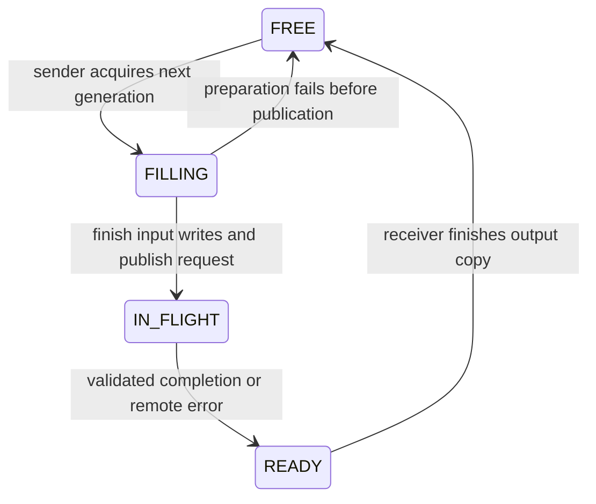

# Registered buffers and double buffering (v0.4)

`SharedPool` allocates 1, 2, or 4 fixed-capacity regions when the client connects. It registers them once over the socket before starting sender/receiver threads. The server validates, maps, and unlinks each name, then retains the mappings until the connection and its running tasks are finished. Repeated calls reference a slot ID and generation; they never reopen an unlinked name. Socket and per-request SHM transports can still share the connection.

```cpp
edgerpc::PoolOptions pool;
pool.slots = 2;
pool.max_elements = 1024;
edgerpc::EdgeRpcClient client("/tmp/edgerpc.sock", edgerpc::kDefaultTimeout, 32, pool);
auto first = client.infer_async(input, edgerpc::Operation::Compute,
                                edgerpc::TensorTransport::SharedPool);
auto second = client.infer_async(other_input, edgerpc::Operation::Compute,
                                 edgerpc::TensorTransport::SharedPool);
```

Inputs may contain zero through the registered maximum number of elements. Oversized inputs and a disabled pool are rejected before submission. Each slot has input at zero and output at `4*max_elements`, so shorter calls retain fixed disjoint ranges. Each tensor is at most 8 MiB; each slot reserves up to 16 MiB, plus possible page rounding for smaller objects. Four maximum slots require 64 MiB of backing storage before vector copies. Registration is synchronous and failures abort construction with RAII cleanup; there is no resize, replacement, unregister, negotiation, or implicit fallback.

## Ownership



The pool mutex protects states and generations inside the client. It is not an inter-process lock. Socket control transfers access between processes:

1. The sender waits for a free slot without holding the pending-request mutex. Acquisition advances that slot's nonzero 64-bit generation. A round-robin preference distributes reuse. The input copy and optional simulated preparation delay happen in FILLING.
2. The sender records the lease and enters IN_FLIGHT before sending the slot reference. It never modifies published storage. The receiver can continue collecting replies while the sender waits for a free slot.
3. The server rejects unknown/busy slots, nonzero reserved bits, stale generations, and counts exceeding registration capacity. An accepted generation must be greater than the previous one; skipped numbers are allowed. The registry is limited to IDs 1–4 per connection. A queued/running task holds its slot busy and retains the mapping.
4. The worker copies input into the vector backend, executes, and copies output to the registered range. It clears busy after its final mapped access and **before** sending completion. It never touches that mapping again for that generation. A valid new request implicitly acknowledges that the client has consumed the preceding result.
5. The client validates request ID, operation, slot, generation, and count before entering READY and copying output into the response vector. Only after that copy may the slot become FREE. Futures own vectors, so later reuse cannot change a delivered result.

The server releases a rejected queue submission before sending OVERLOADED. A valid remote error fails its future and lets the client reclaim that lease. An invalid completion, disconnect, timeout, or close stops the entire pool and wakes blocked acquisition; abandoned executing storage is never recycled on that connection. Threads join before client mappings are dropped. Server mappings remain valid through already-running work, even if the client has unmapped its own view. Queued tasks are discarded on disconnect.

The default client limit still bounds all outstanding calls, including calls waiting for a pool slot. Slot count separately bounds reusable SHM regions. Calls hold input vectors while queued, and vector output copies still occur: this is a reuse pipeline, not a zero-copy backend. FIFO submission means a sender waiting for a pooled slot also delays later socket submissions on that connection. See [shared-memory trust and crash recovery](shared-memory.md); a client killed before all registrations are admitted can still leave named objects requiring identified-name cleanup. Never truncate or mutate published objects.

## Demonstrating overlap

With at least two outstanding calls and two slots, preparation for one input can overlap execution for another. One worker models serialized accelerator execution. More slots may absorb scheduling variation, but no performance improvement is assumed.

```sh
# Existing server in another terminal:
./build/edgerpc_server --socket /tmp/edgerpc.sock --workers 1 --delay-us 1000
./build/edgerpc_demo --socket /tmp/edgerpc.sock --transport pool --mode async \
  --buffer-slots 2 --requests 32 --elements 1024 --verify
mkdir -p results
./build/edgerpc_benchmark --socket /tmp/edgerpc.sock --mode shm-double-buffer \
  --buffer-slots 2 --inflight 4 --prepare-us 1000 --size-kib 4 \
  --requests 1000 --warmup 100 --csv results/pipeline.csv
# Or run a self-contained 1/2/4-slot experiment:
./scripts/run_pipeline_benchmarks.sh
```

`--prepare-us` adds an interruptible delay on the client sender, to model CPU preprocessing; it defaults to zero and applies only to pool mode. `--delay-us` models backend work. These delays demonstrate scheduling overlap, not real model preprocessing or NPU execution. Benchmark mode retains the name `shm-double-buffer` for all 1/2/4-slot variants; `buffer_slots` records the actual configuration.

Both processes record `CLOCK_MONOTONIC` nanoseconds, sharing the host kernel clock. Preparation covers simulated delay plus input copy and request encoding. Queue admission is timestamped just before enqueue. Execution spans worker input copy, backend call/delay, and output copy; it is not pure backend time. `buffer_wait_us` measures acquisition only, excluding earlier sender waiting. Registration/allocation/connect time is reported separately as `initialization_us`, outside warm-up and measured latency. v0.5 also supports optional stage timing for socket and per-request-SHM requests; benchmark timing defaults on. Pool completions retain their original timing even when the added flag is off. See [the benchmark contract](benchmarks.md).

`scripts/analyze_pipeline.py RESULT_DIRECTORY` validates stage ordering and slot generations, checks that preparation of a reused slot starts after its previous execution ended, and counts preparations intersecting another slot's execution. It requires one serialized worker. Retain CSVs to inspect the actual intervals. [The recorded phase-3 evidence](pipeline-evidence.md) includes raw traces, summaries, and environment metadata.

Release and ASan/UBSan tests exercise FSM violations, blocked acquisition/shutdown, registration failures, reversed completions with repeated generations, concurrent callers, mixed transports and tensor sizes, remote error reclamation, stale completions, busy/unknown slots, overload, crashes/restart, zero/max tensors, and a 1,000-request two-slot stress run. Native Mac/ARM64 validation remains pending.
